<p align="center">
  
</p>

<p align="center">
  <a href="https://github.com/check5004/DTXmaniaNXT/releases/latest/download/DTXmaniaNXT-Setup.exe"></a>
</p>

<p align="center">
  <a href="README.md">English</a> · <b>日本語</b>
</p>

<p align="center">
  DTX 譜面で遊べる、無料のドラムゲーム兼練習ソフトです。<br>
  対応 OS は Windows（64bit）。macOS 版・Linux 版も<a href="https://github.com/check5004/DTXmaniaNXT/releases/latest">リリースページ</a>にあります。<br>
  <sub>英語と日本語に対応。非公式のファンメイド作品です。詳しくは<a href="#クレジットと権利">クレジットと権利</a>をご覧ください。</sub>
</p>

<p align="center">
  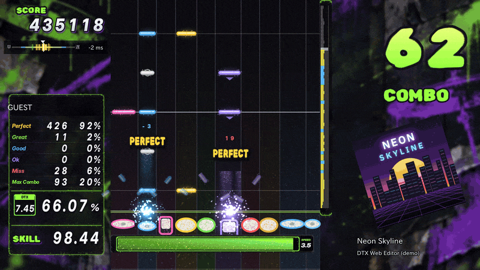
  <br>
  <sub>「Neon Skyline」の MASTER をプレイ中。画像に出てくる曲は、この README 用に用意したデモ曲です（<a href="#画像について">画像について</a>）。</sub>
</p>

## 特長

<table>
<tr>
<td width="33%" valign="top">
<b>🥁 手持ちの DTX 曲がそのまま遊べる</b><br>
曲フォルダを指定するか、ウィンドウにドラッグ＆ドロップするだけ。ダウンロードした zip もドロップすれば追加され、その曲が選ばれます。<code>set.def</code>・<code>box.def</code>、WAV・OGG・MP3 に加え、古い曲で使われている XA 形式の音にも対応しています。
</td>
<td width="33%" valign="top">
<b>🎛️ 電子ドラムにしっかり対応</b><br>
USB-MIDI でつなげばすぐに叩けます。ハイハットの開き具合やチョーク、スネアのリムショット、ベロシティまで読み取ります。キーボードでも遊べます。
</td>
<td width="33%" valign="top">
<b>🎯 フレームに左右されない判定</b><br>
叩いた瞬間の時刻と、曲の再生位置を比べて判定します。画面の更新を待ってから判定することはありません。
</td>
</tr>
<tr>
<td valign="top">
<b>🔁 練習モード</b><br>
数小節をループしながら、70 → 80 → 90 → 100 % とテンポを上げていきます。何度もミスしている拍もひと目で分かります。
</td>
<td valign="top">
<b>📈 苦手が見える</b><br>
叩いたチップは 1 つずつ記録しています。リザルト画面で、苦手な小節やフレーズ、叩き方のクセを確認できます。
</td>
<td valign="top">
<b>🖼️ DTXManiaNX v2.0 と同じ使い心地</b><br>
画面の配置は DTXManiaNX v2.0 のまま、絵と音は新しく作っています。必要なものはすべて内蔵しているので、DTXManiaNX をインストールしておく必要はありません。
</td>
</tr>
</table>

## はじめかた

<p align="center"></p>

1. **インストール**　[DTXmaniaNXT-Setup.exe](https://github.com/check5004/DTXmaniaNXT/releases/latest/download/DTXmaniaNXT-Setup.exe) をダウンロードして実行すると、インストールが終わってそのまま起動します。ユーザーごとのインストールなので、管理者権限は要りません。
   まだコード署名をしていないため、「Windows によって PC が保護されました」と表示されることがあります。その場合は「詳細情報」→「実行」と進んでください。
   初めて起動したときは英語の画面です。**Config** →「General」→「Language」で「日本語」を選ぶと、日本語の表示に切り替わります。
2. **曲を追加**　タイトル画面の **Config** から曲フォルダを追加するか、フォルダをウィンドウにドラッグ＆ドロップします。DTX 譜面が入ったフォルダならどこでもよく、DTXManiaNX の `Songs` フォルダもそのまま使えます。あとから増やす曲は、ダウンロードした zip や曲のフォルダをウィンドウにドロップすれば曲フォルダにコピーされます。
3. **電子ドラムをつないで遊ぶ**　起動前に電子ドラムを USB-MIDI でつないでおけば、自動で認識します。電子ドラムがなくても、キーボードで遊べます。

<details>
<summary><b>操作方法</b></summary>

| 操作 | キーボード | 電子ドラム |
| --- | --- | --- |
| カーソル移動 | <kbd>↑</kbd> <kbd>↓</kbd> | HT / LT |
| 決定 | <kbd>Enter</kbd> | CY |
| 戻る | <kbd>Esc</kbd> | LC |
| 難易度の切り替え（選曲画面） | <kbd>Tab</kbd> | SD / FT |
| 並べ替え（選曲画面） | <kbd>←</kbd> <kbd>→</kbd> | 簡易設定（RD）の「並べ替え」 |
| 簡易設定（選曲画面） | <kbd>F2</kbd> | RD |
| 一時停止（演奏中） | <kbd>Esc</kbd> / <kbd>Space</kbd> | |
| 演奏をやめる（演奏中） | <kbd>Esc</kbd> を 2 回 | |
| 間違えて始めた曲から戻る | <kbd>Esc</kbd> を 2 回 | 最初の音符までに LC を 2 回 |

曲の合間に何気なく叩いても、勝手に何かが始まらないようにしています。

- バスドラムと左ペダル（BD・LP）はメニュー操作に使いません。決定は CY だけです。
- 画面が変わった直後は、少しのあいだパッドが効きません。叩き続けているあいだは、叩くのを止めるまで待ちます。
- リザルト画面のパッドは、ページの切り替え（HT / LT）と戻る（CY / LC）だけです。もう一度・区間練習・リプレイ・補正はキーボード（<kbd>R</kbd> <kbd>P</kbd> <kbd>V</kbd> <kbd>O</kbd>）で操作します。
- <kbd>Esc</kbd> を連打しても 1 画面ずつしか戻らず、アプリは終了しません。

キーボードで叩く場合は、<kbd>A</kbd> <kbd>S</kbd> <kbd>Z</kbd> <kbd>D</kbd> <kbd>G</kbd> <kbd>F</kbd> <kbd>H</kbd> <kbd>J</kbd> <kbd>K</kbd> <kbd>L</kbd> が順に LC・HH・LP・SD・HT・BD・LT・FT・CY・RD、<kbd>Q</kbd> がハイハットオープンです。演奏中は <kbd>↑</kbd> <kbd>↓</kbd> で譜面スピード、<kbd>R</kbd> でリトライ、<kbd>←</kbd> <kbd>→</kbd> で巻き戻し・早送りができます。<kbd>F11</kbd> または <kbd>Alt</kbd>+<kbd>Enter</kbd> で全画面の切り替え、<kbd>F12</kbd> でスクリーンショットを保存します。
</details>

## 遊ぶ

<p align="center">
  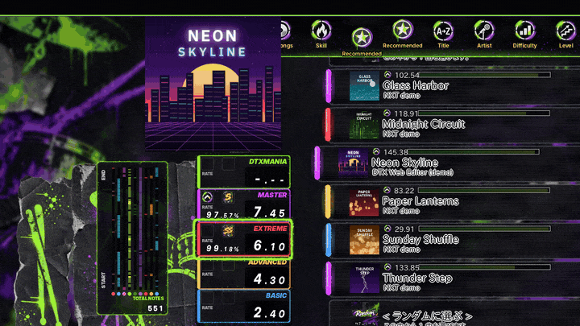
</p>

選曲画面の操作感は DTXManiaNX v2.0 と同じです。フォルダや BOX をたどり、曲名・アーティスト・レベル・スキルなどで並べ替えられます。難易度ごとのクリアランプ、ランク、最高達成率も表示します。
DTXManiaNX で遊んでいた曲なら、`score.ini` に残っている自己ベストを最初に一度だけ取り込むので、ランプやランクは最初から引き継がれます。

<table>
<tr>
<td width="50%" valign="top">
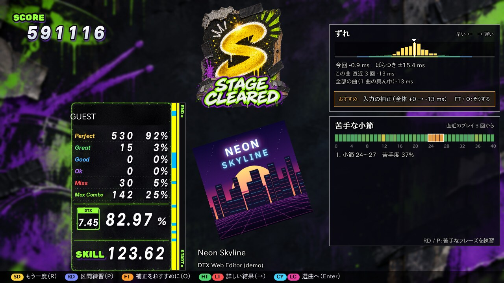
<br><sub>リザルト画面。ずれの分布と、おすすめの補正値も表示します。</sub>
</td>
<td width="50%" valign="top">
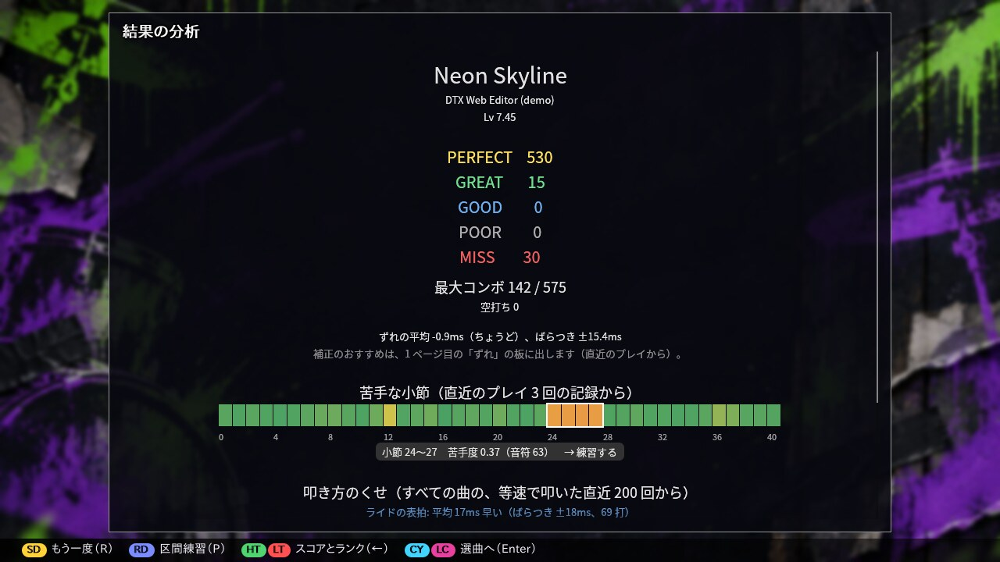
<br><sub>2 ページ目。苦手な小節やフレーズから、そのまま練習を始められます。</sub>
</td>
</tr>
</table>

## 苦手なところを練習する

<p align="center"></p>

選曲画面かリザルト画面で <kbd>P</kbd> キーを押すと、練習メニューが開きます（電子ドラムなら、選曲画面で RD を叩いて開く簡易設定の「この曲を区間練習」）。これまでのプレイから出した苦手な所が並び、それぞれに区間の譜面の絵が付きます。よくミスする音には印が付くので、小節の番号だけでなく、どのフレーズのことかが見て分かります。選んでいる所の音も、練習と同じく 1 小節前のカウントからくり返し流れます。苦手な所を選ぶか、自分で小節を選んで始めます。区間はカウントとメトロノーム付きでループし、遅めのテンポから目標のテンポまで少しずつ上げていきます。練習を終えると練習メニューに戻り、次の苦手な所にカーソルが移ります。

- **1 段は 4 周。** 同じ拍で 2 回ミスしなければ、止まらずに次のテンポへ進みます。
- **同じ拍で 2 回ミスすると**、その段をやり直します。やり直しが 2 回続くと、テンポを 10 % 下げます。
- **いちばん上の段をクリアすると**、その区間は「クリア」として記録されます。あとで曲を通して叩いたとき、その区間がもう苦手でなくなっていれば、リザルト画面に「克服！」と表示されます。
- テンポを落としても、曲の音程は変わりません。判定幅は実際のミリ秒のままなので、ゆっくり叩いても判定が甘くなることはありません。

<table>
<tr>
<td width="50%" valign="top">
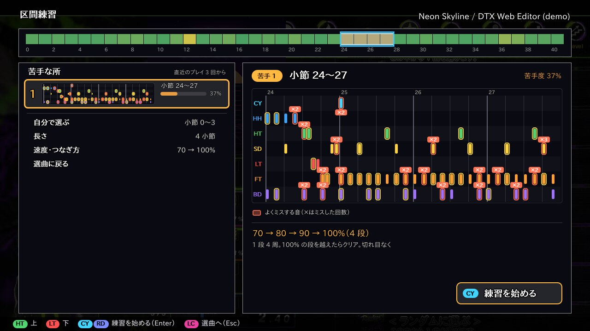
<br><sub>練習メニュー。苦手な所が譜面の絵で分かります。</sub>
</td>
<td width="50%" valign="top">
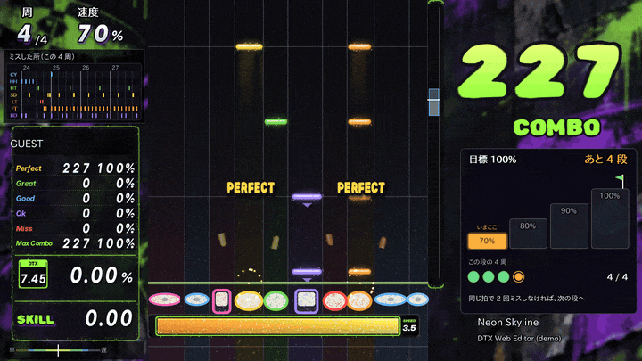
<br><sub>ノーミスで 1 段クリア。次のテンポへ進みます。</sub>
</td>
</tr>
<tr>
<td valign="top">
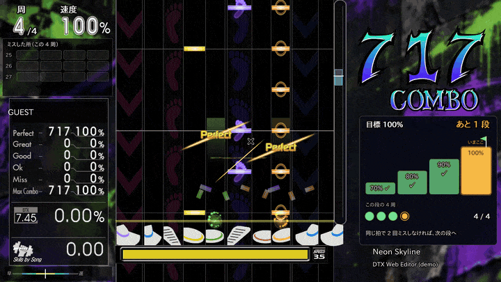
<br><sub>最後の段をクリア。</sub>
</td>
<td valign="top">
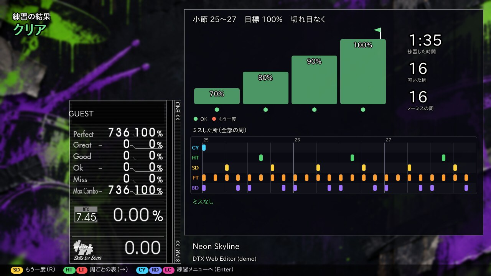
<br><sub>練習の結果。どこでミスしたかも分かります。このあと練習メニューに戻ります。</sub>
</td>
</tr>
</table>

## 判定のしくみ

<p align="center"></p>

電子ドラムからの入力は、受け取った瞬間に時刻を記録し、曲が実際にどこまで再生されているかと比べて判定します。ウィンドウサイズやフレームレートによって判定が変わることはありません。

<p align="center"></p>

- **ずれのバー**　演奏中、スコアの下にある小さなバーに、叩くたびに早い・遅いが表示されます。レーンには重なりません。
- **補正**　機材の遅延に合わせる全体の補正と、音源と譜面が少しずれている曲のための曲ごとの補正があります。
- **おすすめの補正値**　リザルト画面で、最近のプレイから補正値を提案します。キーボードの <kbd>O</kbd> を押すと、その値に切り替わります。

## 電子ドラムまわり

<p align="center"></p>

- MIDI 機器ごとに、使う・使わない、プリセット（Roland / GM / なし）、チャンネル、最小ベロシティ、パッドの割り当てを別々に設定できます。
- **叩いて割り当て**　画面の指示に合わせてパッドを順に叩くだけで、割り当てが終わります。
- ハイハットの開き具合（CC4）、シンバルのチョーク、スネアのヘッド・リム・クロススティックを読み取ります。リムの音を使っている譜面では、スネアのチップにリムの印が付きます。
- ツインペダル用の左バスドラムに対応しています。表示方法は 4 種類から選べます。
- 音量ミキサー（全体・BGM・叩いた音・メトロノーム・効果音）も備えています。

## アップデート

<p align="center"></p>

新しいバージョンが出ると、タイトルメニューの下に表示されます（Windows で Setup.exe からインストールした場合）。選ぶと遊びながらダウンロードし、再起動すると新しいバージョンに切り替わります。設定やプレイ記録はそのまま残ります。

## よくある質問

<details>
<summary><b>DTXManiaNX や DTXMania は必要ですか？</b></summary>

必要ありません。画面の画像や効果音も含めて、必要なものはすべてインストーラーに入っています。曲だけ用意してください。
</details>

<details>
<summary><b>DTXManiaNX の曲や記録は使えますか？</b></summary>

使えます。NX の曲フォルダ（または NX のフォルダごと）を追加してください。曲の読み込み時に、DTXManiaNX の `score.ini` から自己ベスト（達成率・スコア・進み具合のバー）を一度だけ取り込むので、ランプ・ランク・スキルも引き継がれます。チップごとの結果は `score.ini` に入っていないため、苦手の分析は DTXmaniaNXT で遊んだ分から始まります。
</details>

<details>
<summary><b>画面が英語で表示されます</b></summary>

初めて起動したときは英語の画面になります。**Config** →「General」→「Language」で「日本語」を選んでください。メニューやメッセージが日本語に切り替わります（曲名やスキンの絵に描かれた文字はそのままです）。
</details>

<details>
<summary><b>ギターやベースは遊べますか？</b></summary>

遊べません。DTXmaniaNXT はドラム専用です。
</details>

<details>
<summary><b>macOS や Linux で使うには？</b></summary>

[リリースページ](https://github.com/check5004/DTXmaniaNXT/releases/latest)から OS に合った `.tar.gz` をダウンロードして展開します。macOS ではアプリに署名していないため、初回起動の前に、展開したフォルダで `xattr -d com.apple.quarantine dtxmanianxt` を実行してください。Linux では ALSA（`libasound2`）が必要です。自動アップデートは Windows 版だけの機能です。
</details>

<details>
<summary><b>譜面の動画（#AVI）は再生できますか？</b></summary>

Windows 版なら再生できます。Windows の Media Foundation を使って、レーンの後ろに流します（MP4 の H.264、AVI の Xvid・DivX など）。macOS 版・Linux 版はまだ対応していません。
</details>

<details>
<summary><b>設定や記録はどこに保存されますか？</b></summary>

Windows では `%APPDATA%\DTXmaniaNXT` に保存されます（設定の `config.toml`、チップ 1 つ 1 つまで残るプレイ記録の `records.sqlite`、ログの `dtxmanianxt.log`）。アップデートや再インストールをしても消えません。アンインストールは Windows の「設定」→「アプリ」から行えます。このときも設定と記録は残ります。
</details>

<details>
<summary><b>自分で譜面を作りたいときは？</b></summary>

同じ作者による、ブラウザで使える無料のドラム譜面エディタ [DTX Web Editor](https://github.com/check5004/dtx-mania-web-editor) をどうぞ。設定の「曲」→「譜面エディタを開く」からも開けます。保存した曲フォルダは、DTXmaniaNXT でも DTXMania でもそのまま遊べます。直した譜面は「曲を再読み込み」で一覧に反映されます。
</details>

<details>
<summary><b>うまく動かないときは？</b></summary>

[Issue](https://github.com/check5004/DTXmaniaNXT/issues) でお知らせください。上のフォルダにある `dtxmanianxt.log` を添えていただけると助かります。
</details>

**詳しい使い方**（設定項目の一覧、練習モードのルール、保存されるファイルなど）は [docs/guide.ja.md](docs/guide.ja.md) にまとめています。

## クレジットと権利

DTXmaniaNXT は**非公式のファンメイド作品**です。2000 年から続く DTXMania と、その派生版を作り育ててきた方々の積み重ねがあってこそ生まれました。DTXMania に関わってきたすべての皆さまに感謝します。

<p align="center">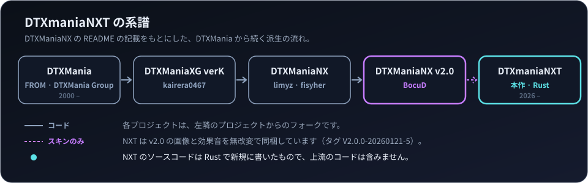</p>

### DTXMania と派生版

| プロジェクト | 作者 | 説明 |
| --- | --- | --- |
| [DTXMania](https://dtxmania.net/) | FROM | DTXMania の本家で、DTX 形式の生みの親です。2000 年から公開され、現在も開発が続いています（DTXMania 4）。サイトの著作権表示は「© 2000 FROM / Kenji yamazaki」、使用許諾書の著作権表示は「Copyright (C) 2000 2010 DTXMania Group」です。 |
| [DTXMania（OSDN）](https://osdn.net/projects/dtxmania) | yyagi | OSDN で開発されていた DTXMania です。DTX 形式を解説した [Wiki](https://osdn.net/projects/dtxmania/wiki/DTX%20data%20format) もここにあります。 |
| [DTXManiaXG verK](https://osdn.net/projects/dtxmaniaxg-verk) | kairera0467 | DTXManiaNX のフォーク元です。 |
| [DTXManiaNX](https://github.com/limyz/DTXmaniaNX) | limyz / fisyher | このリポジトリは、GitHub 上でこれをフォークしています。 |
| [DTXManiaNX v2.0](https://github.com/BocuD/DTXmaniaNX) | BocuD | 画面レイアウトはこのバージョンにならっています。NXT のスキンは、このバージョンのスキンから始めました（今はすべて置き換え済み）。 |
| [DTXMania AL](http://senamih.com/dtxal) | Sena | DTXManiaNX の README で、ほかの派生版と並んで紹介されている派生版です。 |

プロジェクト名と並び順は、DTXManiaNX の README と各プロジェクトのページに合わせています。誤りがあれば [Issue](https://github.com/check5004/DTXmaniaNXT/issues) でお知らせください。

### このリポジトリの中身

- **ソースコード**（`main` ブランチ）は、このプロジェクトのために Rust で新しく書いたものです。DTXMania・DTXManiaNX のコードは含んでおらず、機能は同じ動きになるよう一から書き起こしています。ライセンスは [MIT](LICENSE) です。
- **スキン**（`assets/skin`。画面の画像と効果音）は、DTXManiaNX v2.0 のスキンから始めて、3 つの段階で**すべて自前の素材に置き換えました**。ファイル名と配置は v2.0 のままで、DTXManiaNX がなくても動くよう、アプリに埋め込んでいます。ファイルごとの内訳は [assets/README.md](assets/README.md) にあります。

  | 段階 | 範囲 | 状態 |
  | --- | --- | --- |
  | 1 | KONAMI の「GITADORA」の絵やロゴが入っていた画像（背景、タイトルのロゴ、シャッター、STAGE FAILED、ランクなど） | DTXmaniaNXT のために作った素材に**置き換え済み**（23 ファイル）。使っていなかったものは削除 |
  | 2 | 効果音とボイス | DTXmaniaNXT のために作った音に**置き換え済み**（25 ファイル）。使っていなかったものは削除 |
  | 3 | そのほかの画像（レーン、チップ、パッド、判定の文字、数字、ゲージ、選曲の帯、並べ替えのアイコンなど） | DTXmaniaNXT のために作った素材に**置き換え済み**（116 ファイル）。使っていなかったものは削除 |

  - **自前の素材**は [CC BY 4.0](https://creativecommons.org/licenses/by/4.0/deed.ja) です。使うときは「DTXmaniaNXT」と表記してください。ただし、**ボイスは扱いが異なります**（下を参照）。
    - 画像（段階 1）: 画像生成 AI（OpenAI の GPT Image 2.6 Sunburst を OpenRouter 経由で使用）で絵を作り、切り抜き・縮小・文字入れをしています。生成の指示文は `tools/skin/prompts.json` にあり、既存のゲームや製品の名前は入れていません。
    - 画像（段階 3）: ほとんどは `tools/skin/build_stage3.py` で図形とフォント（Rubik Spray Paint と Inter。どちらも SIL Open Font License）から描きました。結果の文字、並べ替えのアイコン、練習の合格のメダルは、同じ画像生成 AI で作った 2 枚の絵から切り出しています。
    - 操作音: `tools/skin/ui_sounds.py` で合成しました。
    - タイトル曲と、クリア・フルコンボ・開始・読み込み中などの短い曲: Google の音楽生成モデル Lyria 3（OpenRouter 経由）で作りました。指示文に既存の曲や演奏者の名前は入れていません。Lyria の出力には、耳では聞こえない透かし（SynthID）が入っています。
    - ボイス（難易度や並べ替えの読み上げと、短い曲に重ねた声）: **VOICEVOX:春日部つむぎ**。CC BY 4.0 も MIT ライセンスも適用されず、[VOICEVOX の利用規約](https://voicevox.hiroshiba.jp/term/)と[春日部つむぎの利用規約](https://tsumugi-official.studio.site/rule)に従います。DTXmaniaNXT の中で鳴らすためのものなので、取り出してほかの作品に使ったり、配布したりしないでください。アプリでも、Config の「全般」にある「クレジット」に表示しています。
  - **過去のリリース**には、DTXManiaNX v2.0 のスキン（[BocuD/DTXmaniaNX](https://github.com/BocuD/DTXmaniaNX) のタグ `V2.0.0-20260121-5` にある `Runtime/System` フォルダ）のファイルが残っています。段階 1 の画像は 0.8.0 まで、音は 0.9.1 まで、段階 3 の画像は 0.10.0 までのリリースで、過去のコミットも同じです。これらのファイルには MIT ライセンスも CC BY 4.0 も適用されません。権利は元の制作者にありますが、絵ごとの制作者の記録は残っていません。DTXManiaNX のリポジトリにはライセンスファイルがなく、上流に含まれている DTXMania の使用許諾書（`Runtime/Licenses/dtxmania.txt`、MIT ライセンスと同等の内容）は DTXMania 本体のソフトウェアを対象としたもので、これらのファイルには及びません。
- **アプリのアイコン**は、DTXManiaNX の `dtx.ico`（DTXMania から受け継がれてきたアイコン）の「DTX」の文字を「NXT」に描き換えたものです。こちらも MIT ライセンスの対象外です。
- **`master` ブランチ**には、参考として上流の C# 版 DTXManiaNX のコードを残しています。このリポジトリのライセンスは適用されません。

### 商標について

「GITADORA」は株式会社コナミデジタルエンタテインメントの商標です。画面の配置は KONAMI の「GITADORA」シリーズにならっています。0.8.0 までの同梱スキンには、「GITADORA FUZZ-UP」の絵やロゴがそのまま入った画像がありましたが、段階 1 ですべて置き換えました。0.10.0 までは、DTXManiaNX v2.0 から残っていた部品の中に GITADORA の画面に似せたものがありましたが、段階 3 で置き換えました。DTXmaniaNXT は KONAMI とは一切関係がなく、KONAMI や DTXMania・DTXManiaNX の開発者による公認を受けたものでもありません。

**権利者の方で、修正や削除をご希望のものがありましたら、[Issue](https://github.com/check5004/DTXmaniaNXT/issues) でお知らせください。速やかに対応します。**

### その他のクレジット

- ボイス: **VOICEVOX:春日部つむぎ**（[VOICEVOX](https://voicevox.hiroshiba.jp/)）
- XA 形式の音声のデコードは、[bjxa](https://github.com/dridi/bjxa) のマニュアル `bjxa(5)` にある形式の解説をもとに実装しました。コードは流用していません。
- [wgpu](https://wgpu.rs/)・[egui](https://github.com/emilk/egui)・[winit](https://github.com/rust-windowing/winit)・[cpal](https://github.com/RustAudio/cpal)・[midir](https://github.com/Boddlnagg/midir)・[Symphonia](https://github.com/pdeljanov/Symphonia)・[rusqlite](https://github.com/rusqlite/rusqlite)・[timestretch](https://github.com/robmorgan/timestretch-rs)・[Velopack](https://velopack.io/) などのオープンソースソフトウェアを使用しています。各ライセンスは、[リリース](https://github.com/check5004/DTXmaniaNXT/releases)ごとに添付している `THIRD-PARTY-LICENSES.html` に記載しています。
- 姉妹プロジェクト：ドラム譜面エディタ [DTX Web Editor](https://github.com/check5004/dtx-mania-web-editor)

### 画像について

スクリーンショットと動画は開発中のビルドで撮影したため、配布中のバージョンとは細部が異なる場合があります。画面はすべて自前の素材に置き換えた今のスキンで、日本語の表示で撮っています（英語の README には英語の画面を載せています）。画像に出てくる曲はすべてデモ用で、実在の曲ではありません。「Neon Skyline」は DTX Web Editor のオリジナルのデモ曲で、それ以外の曲名は、その譜面を複製して架空の名前を付けたものです。表示されている記録も、撮影用に用意したものです。

## 開発者向け

Cargo のワークスペース構成です。Rust（stable）があればビルドできます（Linux では `libasound2-dev` も必要です）。

```sh
cargo run -p dtxmanianxt                        # タイトル画面から起動
cargo run -p dtxmanianxt -- path/to/song.dtx    # 指定した譜面をすぐに遊ぶ
cargo fmt --all --check
cargo clippy --all-targets -- -D warnings
cargo test --all
```

`DTXMANIANXT_AUTOPLAY=1` を付けて起動すると、すべてのチップを自動で叩きます（画面の確認用）。

| ディレクトリ | 内容 |
| --- | --- |
| `crates/dtx` | DTX の読み込み（文字コード判定、ヘッダ、チップ、BPM と小節長からの時刻計算） |
| `crates/engine` | 判定、音声と MIDI の時計、電子ドラムの入力の正規化、苦手の分析、練習のループ |
| `crates/library` | 曲フォルダの読み込み（`set.def`・`box.def`）と、選曲画面の並べ替え |
| `crates/records` | プレイ記録（SQLite） |
| `crates/nx` | DTXManiaNX のフォルダの読み込み（`Config.ini`・`score.ini`） |
| `crates/video` | 譜面の動画（#AVI）。Windows では Media Foundation を使用 |
| `crates/i18n` | 画面に出す英語と日本語の文 |
| `crates/drum_module` | 電子ドラムの音源と MIDI でやり取りする部分（Roland V71・V51・V31 の SysEx、番地表、書き換えた値の書き戻し） |
| `crates/app` | アプリ本体（winit + wgpu + egui、cpal、midir）。NX のスキンを上流と同じ座標で描画 |
| `assets/skin` | 同梱しているスキン。絵も音もすべて自前の素材（[クレジットと権利](#クレジットと権利)を参照） |
| `tools/skin` | 新しいスキンの素材（絵と音）の生成の指示文と組み立て |
| `testdata/charts` | テスト用の譜面と、手計算で確かめた正解データ |

- 判定は画面のフレームではなく、MIDI の受信時刻と音声の再生位置で行います。
- DTX の解釈は、上流の DTXMania の挙動と [DTX Web Editor](https://github.com/check5004/dtx-mania-web-editor) の `src/dtx` に合わせています。解釈を変えたときは、`testdata/charts` に譜面と正解データを追加してください。
- リリース：`main` の `Cargo.toml` の `version` を上げると、Release ワークフローがインストーラー・自動アップデート用のファイル・macOS／Linux 版を作成します。手順は [docs/releasing.md](docs/releasing.md) を参照してください。
- README の図：アニメーション SVG は `python3 tools/readme/make_svgs.py` で生成します（標準ライブラリのみ、英語版と日本語版）。演奏の動画は、`tools/readme/player.py` で譜面どおりにキー入力を送って撮影しています。

PR はフォーク元の上流ではなく、このリポジトリ（check5004/DTXmaniaNXT）の `main` に向けて出してください。

## ライセンス

`main` ブランチのソースコードは [MIT ライセンス](LICENSE)です。`assets/skin` のスキン（自前の素材は CC BY 4.0。ただしボイスは VOICEVOX と春日部つむぎの規約に従います）、`assets/icon` のアイコン、`master` ブランチにある上流のコードには適用されません（[クレジットと権利](#クレジットと権利)を参照）。
