<p align="center">
  
</p>

<p align="center">
  <a href="https://github.com/check5004/DTXmaniaNXT/releases/latest/download/DTXmaniaNXT-Setup.exe"></a>
</p>

<p align="center">
  <a href="README.md">English</a> · <b>日本語</b>
</p>

<p align="center">
  DTXMania の曲の形式 <b>DTX</b> の譜面で遊べる、無料のドラムのゲーム兼練習アプリです。<br>
  Windows（64 ビット）。macOS（Apple シリコン）と Linux（x86_64）の版も<a href="https://github.com/check5004/DTXmaniaNXT/releases/latest">リリースのページ</a>にあります。<br>
  <sub>非公式のファンメイドのプロジェクトです。<a href="#クレジットと権利">クレジットと権利</a>もご覧ください。</sub>
</p>

<p align="center">
  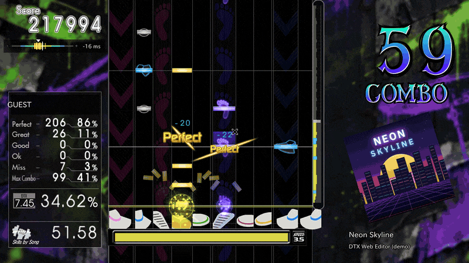
  <br>
  <sub>「Neon Skyline」の MASTER を叩いているところ。画面に出る曲は、この README のために作ったデモ曲です（<a href="#画像について">画像について</a>）。</sub>
</p>

## できること

<table>
<tr>
<td width="33%" valign="top">
<b>🥁 手持ちの DTX の曲で遊べる</b><br>
曲のフォルダを選ぶか、ウィンドウにドロップするだけ。<code>set.def</code>・<code>box.def</code>、WAV・OGG・MP3、古い曲の XA の音も鳴ります。
</td>
<td width="33%" valign="top">
<b>🎛️ 電子ドラムのために</b><br>
USB-MIDI でつないで叩くだけ。ハイハットの開き具合・チョーク・スネアのリム・強さまで読みます。キーボードでも遊べます。
</td>
<td width="33%" valign="top">
<b>🎯 正直な判定</b><br>
叩いた音が届いた時刻を、曲の音が鳴っている位置と比べて判定します。次の画面のフレームを待ちません。
</td>
</tr>
<tr>
<td valign="top">
<b>🔁 練習モード</b><br>
数小節をくり返し、70 → 80 → 90 → 100 % と段をのぼります。何度もミスする拍をそのまま見せます。
</td>
<td valign="top">
<b>📈 苦手が分かる</b><br>
叩いた音符は 1 つずつ記録します。結果の画面に、苦手な小節・苦手なフレーズ・叩き方のくせが出ます。
</td>
<td valign="top">
<b>🖼️ DTXManiaNX v2.0 の見た目</b><br>
DTXManiaNX v2.0 の画面と音がアプリに入っています。DTXManiaNX を入れておく必要はありません。
</td>
</tr>
</table>

## はじめかた

<p align="center"></p>

1. **入れる**　[DTXmaniaNXT-Setup.exe](https://github.com/check5004/DTXmaniaNXT/releases/latest/download/DTXmaniaNXT-Setup.exe) をダウンロードして実行します。管理者の権限なしで、使っている Windows のユーザーに入れて、そのまま起動します。
   まだ署名をしていないので「Windows によって PC が保護されました」と出ることがあります。「詳細情報」を押してから「実行」を押してください。
2. **曲を足す**　タイトルの画面で **Config** を選んで曲のフォルダを足すか、フォルダをウィンドウにドロップします。DTX の譜面が入ったフォルダなら何でもよく、DTXManiaNX の `Songs` フォルダもそのまま使えます。
3. **つないで遊ぶ**　電子ドラムを USB-MIDI でつないでから起動すれば、自動で見つけます。電子ドラムが無ければキーボードで叩けます。

<details>
<summary><b>操作</b></summary>

| | キーボード | 電子ドラム |
| --- | --- | --- |
| 動かす | <kbd>↑</kbd> <kbd>↓</kbd> | HT / LT |
| 決める | <kbd>Enter</kbd> | CY |
| 戻る | <kbd>Esc</kbd> | LC |
| 難易度（選曲） | <kbd>Tab</kbd> | HH を 2 回 |
| 並べ替え（選曲） | <kbd>←</kbd> <kbd>→</kbd> | SD / FT |
| 簡易設定（選曲） | <kbd>F2</kbd> | RD |
| 一時停止（演奏中） | <kbd>Esc</kbd> か <kbd>Space</kbd> | |

足で踏むパッド（BD・LP）はメニューの操作に使わないので、曲の合間にうっかり踏んでも何も起きません。

キーボードで叩くときは <kbd>A</kbd> <kbd>S</kbd> <kbd>Z</kbd> <kbd>D</kbd> <kbd>G</kbd> <kbd>F</kbd> <kbd>H</kbd> <kbd>J</kbd> <kbd>K</kbd> <kbd>L</kbd> が LC・HH・LP・SD・HT・BD・LT・FT・CY・RD、<kbd>Q</kbd> がオープンハイハットです。演奏中は <kbd>↑</kbd> <kbd>↓</kbd> で譜面の速さ、<kbd>R</kbd> でやり直し、<kbd>←</kbd> <kbd>→</kbd> で巻き戻しと早送り。<kbd>F11</kbd> か <kbd>Alt</kbd>+<kbd>Enter</kbd> で全画面、<kbd>F12</kbd> で画面を画像に残します。
</details>

## 遊ぶ

<p align="center">
  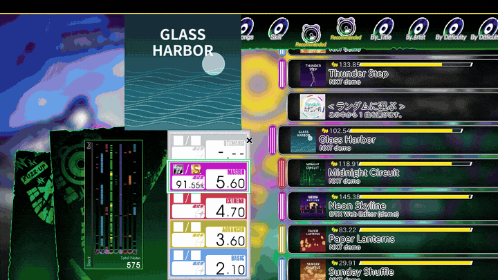
</p>

選曲は DTXManiaNX v2.0 と同じ使い心地です。フォルダや BOX をたどり、曲名・アーティスト・レベル・スキルなどで並べ替え、難易度ごとのランプ・ランク・一番の達成率を見られます。
DTXManiaNX で遊んだ曲なら、`score.ini` に残っている一番の記録を一度だけ引き継ぐので、初めからランプとランクがそろいます。

<table>
<tr>
<td width="50%" valign="top">
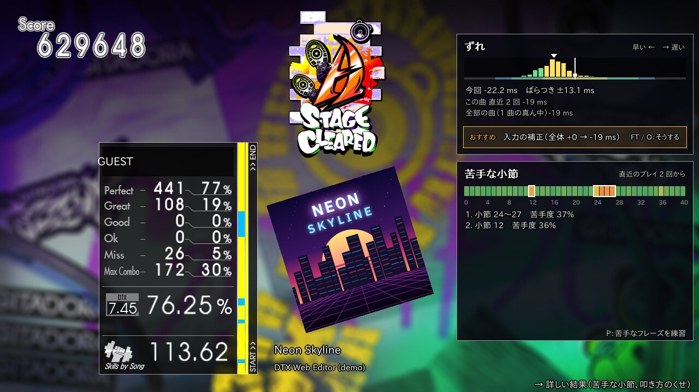
<br><sub>結果の画面。ずれと補正のおすすめも出ます。</sub>
</td>
<td width="50%" valign="top">
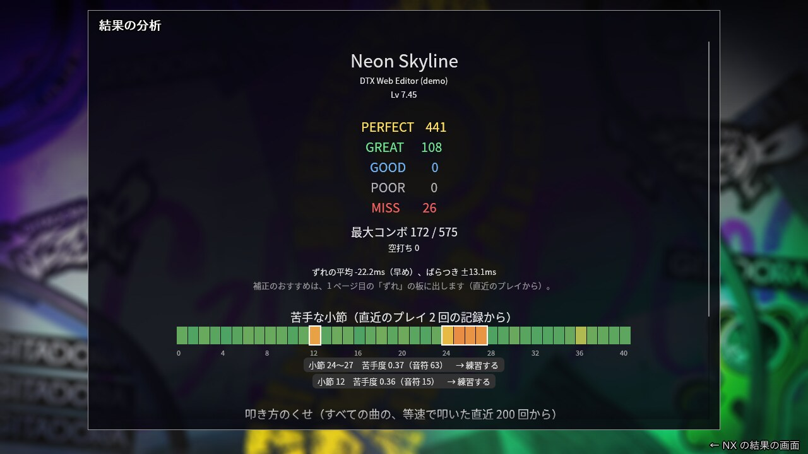
<br><sub>2 ページ目。苦手な小節とフレーズから、そのまま練習へ。</sub>
</td>
</tr>
</table>

## 苦手な所を練習する

<p align="center"></p>

選曲か結果の画面で <kbd>P</kbd> を押し（電子ドラムなら RD で開く簡易設定から）、数小節か苦手なフレーズを選んで始めます。区間はカウントとメトロノーム付きでくり返し、遅い速度から目標の速度まで上がっていきます。

- **1 段は 4 周**。同じ拍で 2 回ミスしなければ、止まらずに次の速度へ進みます。
- **同じ拍で 2 回ミスしたら**、その段をもう一度。2 回続いたら 10 % 下げます。
- **いちばん上の段を越えると**、その区間はクリアとして残ります。あとで曲を通して叩いて、その所がもう苦手でなくなっていれば、結果の画面で知らせます。
- 遅くしても曲の音程は変わりません。判定の幅は実際のミリ秒のままなので、遅い周でも判定は甘くなりません。

<table>
<tr>
<td width="50%" valign="top">
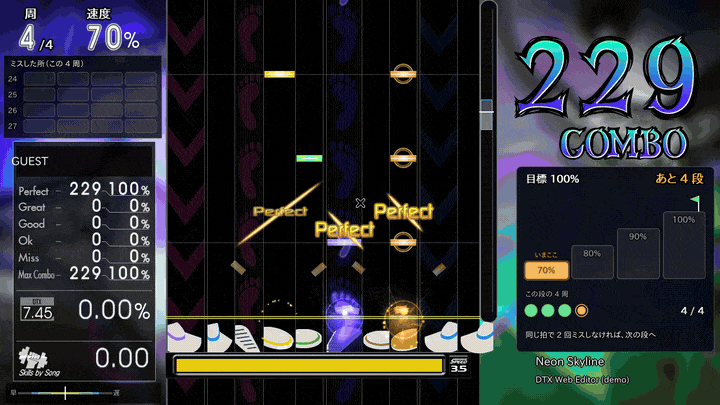
<br><sub>ノーミスなので、次の速度へ。</sub>
</td>
<td width="50%" valign="top">

<br><sub>いちばん上の段をクリア。</sub>
</td>
</tr>
<tr>
<td valign="top">
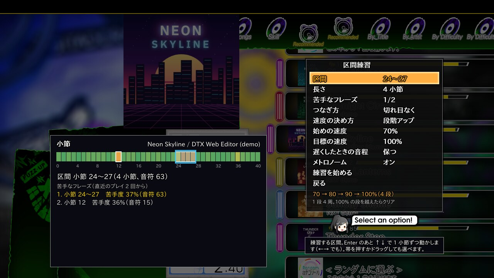
<br><sub>区間・速度・メトロノームを選びます。</sub>
</td>
<td valign="top">
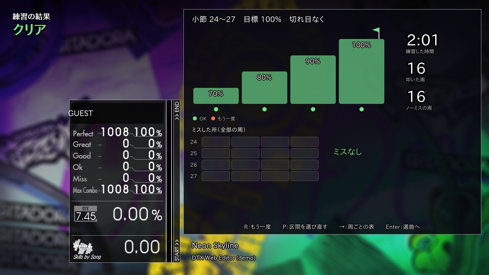
<br><sub>練習した中身と、ミスした所。</sub>
</td>
</tr>
</table>

## 判定を信じられるように

<p align="center"></p>

電子ドラムの打撃には届いた瞬間の時刻を付け、曲の音が実際にどこまで鳴っているかと比べます。窓の大きさやフレームレートで判定は変わりません。

<p align="center"></p>

- **ずれのバー**　演奏中、スコアの下の小さなバーに、叩くたびに早い・遅いが出ます。レーンにはかぶせません。
- **補正**　機材の遅れに合わせる全体の補正と、曲の音が少しずれている譜面のための曲ごとの補正があります。
- **補正のおすすめ**　結果の画面で、最近のプレイからおすすめの値を出します。FT（キーボードは <kbd>O</kbd>）でその値にします。

## 電子ドラムのために

<p align="center"></p>

- MIDI の機器ごとに、使うかどうか・プリセット（Roland / GM / なし）・チャンネル・最小ベロシティ・パッドの割り当てを持ちます。
- **叩いて割り当て**　アプリが言うレーンのパッドを順に叩くだけで割り当てられます。
- ハイハットの開き具合（CC4）、シンバルのチョーク、スネアのヘッド・リム・クロススティックを読みます。リムの音を使う譜面では、スネアの音符にリムの印が付きます。
- ツインペダル向けの左バスドラム。出し方は 4 通りから選べます。
- 音量のミキサー（全体・BGM・叩いた音・メトロノーム・効果音）。

## 更新

<p align="center"></p>

新しい版が出ると、タイトルのメニューの下に行が出ます（Windows で Setup.exe から入れたとき）。選べば遊びながら落とし、再起動で入れ替わります。設定と遊んだ記録はそのまま残ります。

## よくある質問

<details>
<summary><b>DTXManiaNX や DTXMania を入れておく必要はありますか？</b></summary>

いりません。画面の画像や音も含めて、要るものはインストーラーに入っています。曲だけ用意してください。
</details>

<details>
<summary><b>DTXManiaNX の曲と記録は使えますか？</b></summary>

使えます。NX の曲のフォルダ（か NX のフォルダそのもの）を足してください。曲を探したときに、DTXManiaNX の `score.ini` から一番の記録（達成率・スコア・進み具合のバー）を一度だけ引き継ぐので、ランプ・ランク・スキルもそのままです。音符ごとの結果は入っていないので、苦手の分析は DTXmaniaNXT で遊んだ分から始まります。
</details>

<details>
<summary><b>ギターやベースは遊べますか？</b></summary>

遊べません。DTXmaniaNXT はドラム専用です。
</details>

<details>
<summary><b>画面は英語にできますか？</b></summary>

今は日本語だけです。スキンの絵に描かれた英語はそのままです。
</details>

<details>
<summary><b>macOS や Linux では？</b></summary>

[リリースのページ](https://github.com/check5004/DTXmaniaNXT/releases/latest)から使っている OS の `.tar.gz` を落として展開します。macOS は署名をしていないので、初めて起動する前に、展開したフォルダで `xattr -d com.apple.quarantine dtxmanianxt` を実行してください。Linux は ALSA の `libasound2` が要ります。自動の更新は Windows だけです。
</details>

<details>
<summary><b>譜面の動画（#AVI）は流れますか？</b></summary>

Windows なら流れます。レーンの後ろに、Windows の Media Foundation で読んで流します（MP4 の H.264、AVI の Xvid・DivX など）。macOS と Linux はまだです。
</details>

<details>
<summary><b>設定と記録はどこにありますか？</b></summary>

Windows では `%APPDATA%\DTXmaniaNXT` です（設定の `config.toml`、叩いた音符 1 つずつの記録 `records.sqlite`、ログの `dtxmanianxt.log`）。更新しても入れ直しても残ります。アンインストールは Windows の設定の「アプリ」から。設定と記録は消さずに残します。
</details>

<details>
<summary><b>自分で譜面を作るには？</b></summary>

[DTX Web Editor](https://github.com/check5004/dtx-mania-web-editor) を使ってください。ブラウザで動く無料のドラム譜面エディタです（同じ作者）。保存した曲のフォルダは、このアプリでも DTXMania でもそのまま遊べます。
</details>

<details>
<summary><b>うまく動きません。</b></summary>

[Issue](https://github.com/check5004/DTXmaniaNXT/issues) で知らせてください。上のフォルダの `dtxmanianxt.log` を添えてもらえると、とても助かります。
</details>

**詳しい使い方**（設定の一つ一つ、練習の決まり、アプリが書くファイル）は [docs/guide.ja.md](docs/guide.ja.md) にあります。

## クレジットと権利

DTXmaniaNXT は**非公式のファンメイドのプロジェクト**です。20 年を超える DTXMania のコミュニティの積み重ねがなければ、生まれませんでした。DTXMania とその派生版を作り、続けてきたすべての方に感謝します。

<p align="center"></p>

### DTXMania のなかま

| プロジェクト | 作者 | |
| --- | --- | --- |
| [DTXMania](https://dtxmania.net/) | FROM | 最初の DTXMania と DTX の形式。2000 年から続き、今も開発されています（DTXMania 4）。サイトの表記は「© 2000 FROM / Kenji yamazaki」、DTXMania の使用許諾の表記は「Copyright (C) 2000 2010 DTXMania Group」です。 |
| [DTXMania（OSDN）](https://osdn.net/projects/dtxmania) | yyagi | OSDN で開発された DTXMania。[DTX の形式の Wiki](https://osdn.net/projects/dtxmania/wiki/DTX%20data%20format) もここにあります。 |
| [DTXManiaXG verK](https://osdn.net/projects/dtxmaniaxg-verk) | kairera0467 | DTXManiaNX のフォーク元。 |
| [DTXManiaNX](https://github.com/limyz/DTXmaniaNX) | limyz / fisyher | このリポジトリは GitHub でこれをフォークしたものです。 |
| [DTXManiaNX v2.0](https://github.com/BocuD/DTXmaniaNX) | BocuD | 画面の配置と、同梱しているスキンはこの版のものです。 |
| [DTXMania AL](http://senamih.com/dtxal) | Sena | DTXManiaNX の README にほかの版と並んで載っている派生版です。 |

名前と順番は DTXManiaNX の README と、それぞれのプロジェクトのページに合わせました。間違いがあれば [Issue](https://github.com/check5004/DTXmaniaNXT/issues) で教えてください。

### このリポジトリに入っているもの

- **コード**（`main` ブランチ）は、このプロジェクトのために Rust で新しく書いたものです。DTXMania と DTXManiaNX のコードは入っていません。機能は同じふるまいになるように書き直しています。[MIT ライセンス](LICENSE)です。
- **スキン**（`assets/skin`、画面の画像と効果音）は、[BocuD/DTXmaniaNX](https://github.com/BocuD/DTXmaniaNX) のタグ `V2.0.0-20260121-5` の `Runtime/System` フォルダを、中身を変えずに写したものです（背景の動画 2 つと、Windows が作る `Thumbs.db`・`desktop.ini` だけは入れていません）。DTXManiaNX が無くても動くように、アプリに埋め込んでいます。**MIT ライセンスは及びません。** 権利は DTXMania と DTXManiaNX のそれぞれの作者にあります。DTXManiaNX のリポジトリにはライセンスのファイルが無く、DTXMania の使用許諾（`Runtime/Licenses/dtxmania.txt`、MIT と同じ形）は DTXMania のソフトウェアについてのものです。詳しくは [assets/README.md](assets/README.md) にあります。
- **アプリのアイコン**は、DTXManiaNX の `dtx.ico`（DTXMania から受け継がれてきたアイコン）の「DTX」の文字を「NXT」にしたものです。これにも MIT ライセンスは及びません。
- **`master` ブランチ**は、上流の C# の DTXManiaNX のコードを参考に残しているだけです。このリポジトリのライセンスは及びません。

### 商標

画面のデザインは KONAMI の「GITADORA」シリーズに倣ったもので、スキンには「GITADORA」「FUZZ-UP」「Tri-Boost」の名前やロゴを含む画像があります。「GITADORA」は株式会社コナミデジタルエンタテインメントの商標です。DTXmaniaNXT は KONAMI とは関係がなく、KONAMI からも、DTXMania・DTXManiaNX の開発者からも認められたものではありません。

**ここにあるものの権利をお持ちの方で、直したり取り下げたりしてほしいものがあれば、[Issue](https://github.com/check5004/DTXmaniaNXT/issues) でお知らせください。すぐに対応します。**

### そのほかのクレジット

- XA の音の読み方は、[bjxa](https://github.com/dridi/bjxa) の説明書 `bjxa(5)` の形式の説明をもとに書きました。コードは借りていません。
- [wgpu](https://wgpu.rs/)・[egui](https://github.com/emilk/egui)・[winit](https://github.com/rust-windowing/winit)・[cpal](https://github.com/RustAudio/cpal)・[midir](https://github.com/Boddlnagg/midir)・[Symphonia](https://github.com/pdeljanov/Symphonia)・[rusqlite](https://github.com/rusqlite/rusqlite)・[timestretch](https://github.com/robmorgan/timestretch-rs)・[Velopack](https://velopack.io/) などのオープンソースを使っています。それぞれのライセンスは、[リリース](https://github.com/check5004/DTXmaniaNXT/releases)ごとに付けている `THIRD-PARTY-LICENSES.html` にあります。
- 姉妹プロジェクト：譜面エディタの [DTX Web Editor](https://github.com/check5004/dtx-mania-web-editor)。

### 画像について

画面の画像と動画は開発中のビルドで撮ったので、ダウンロードした版とは細かい所が違うことがあります。画面に出る曲はすべて、この画像のために用意したデモ曲で、実在の曲ではありません。「Neon Skyline」は DTX Web Editor のオリジナルのデモ曲、ほかの曲名はこの README のために作った短い譜面です。画面に出る記録も作ったものです。

## 開発者向け

Cargo のワークスペースです。Rust（stable）だけあればビルドできます（Linux は `libasound2-dev` も）。

```sh
cargo run -p dtxmanianxt                        # タイトルから
cargo run -p dtxmanianxt -- path/to/song.dtx    # その譜面をすぐ遊ぶ
cargo fmt --all --check
cargo clippy --all-targets -- -D warnings
cargo test --all
```

画面を確かめるときは `DTXMANIANXT_AUTOPLAY=1` を付けて起動すると、音符を自動で叩きます。

| 場所 | 中身 |
| --- | --- |
| `crates/dtx` | DTX の読み込み（文字コード、ヘッダ、チップ、BPM と小節長から時刻を計算） |
| `crates/engine` | 判定、音と MIDI の時計、電子ドラムの入力の正規化、苦手の分析、練習の区間ループ |
| `crates/library` | 曲のフォルダの探し方（`set.def`・`box.def`）と選曲の並べ替え |
| `crates/records` | 遊んだ記録（SQLite） |
| `crates/nx` | DTXManiaNX のフォルダの読み方（`Config.ini`・`score.ini`） |
| `crates/video` | 譜面の動画（#AVI）。Windows は Media Foundation で読む |
| `crates/app` | アプリ本体（winit + wgpu + egui、cpal、midir）。NX のスキンを上流と同じ座標で描く |
| `assets/skin` | 同梱の DTXManiaNX v2.0 のスキン（[クレジットと権利](#クレジットと権利)） |
| `testdata/charts` | テスト譜面と手計算の正解 |

- 判定は画面のフレームではなく、MIDI の受信時刻と音の再生位置で行います。
- DTX の読み方は上流の DTXMania のふるまいと [DTX Web Editor](https://github.com/check5004/dtx-mania-web-editor) の `src/dtx` に合わせます。読み方を変えたら `testdata/charts` に譜面と正解を足します。
- リリース：`main` の `Cargo.toml` の `version` を上げると、Release のワークフローがインストーラー・自動更新の材料・macOS と Linux の版を作ります。[docs/releasing.md](docs/releasing.md) を見てください。
- README の図：アニメーションする SVG は `python3 tools/readme/make_svgs.py` で作ります（標準ライブラリだけ、英語と日本語）。

PR はこのリポジトリ（check5004/DTXmaniaNXT）の `main` 宛てに出してください（フォーク元の上流ではなく）。

## ライセンス

`main` ブランチのコードは [MIT ライセンス](LICENSE)です。`assets/skin` の同梱スキン、`assets/icon` のアイコン、`master` ブランチの上流のコードには及びません（[クレジットと権利](#クレジットと権利)）。
