<p align="center">
  
</p>

<p align="center">
  <a href="https://github.com/check5004/DTXmaniaNXT/releases/latest/download/DTXmaniaNXT-Setup.exe"></a>
</p>

<p align="center">
  <b>English</b> · <a href="README.ja.md">日本語</a>
</p>

<p align="center">
  A free drum game and practice app for <b>DTX charts</b>, the song format of DTXMania.<br>
  Windows (64-bit). macOS (Apple silicon) and Linux (x86_64) builds are on the <a href="https://github.com/check5004/DTXmaniaNXT/releases/latest">releases page</a>.<br>
  <sub>In English and Japanese. An unofficial fan project: see <a href="#credits-and-rights">Credits and rights</a>.</sub>
</p>

<p align="center">
  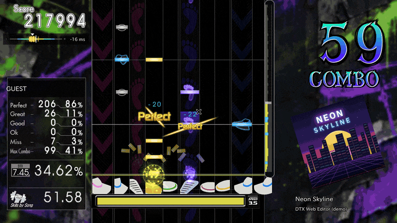
  <br>
  <sub>Playing “Neon Skyline” on MASTER. The songs in these pictures are demo songs made for this README (see <a href="#about-the-pictures">About the pictures</a>).</sub>
</p>

## What it does

<table>
<tr>
<td width="33%" valign="top">
<b>🥁 Plays your DTX songs</b><br>
Point it at your song folder, or drop the folder on the window. <code>set.def</code>, <code>box.def</code>, WAV / OGG / MP3 and old XA sounds all work.
</td>
<td width="33%" valign="top">
<b>🎛️ Made for electronic drums</b><br>
Plug in by USB-MIDI and play. Hi-hat openness, chokes, snare rim shots and velocity are read. The keyboard works too.
</td>
<td width="33%" valign="top">
<b>🎯 Fair timing</b><br>
Each hit is judged by when it arrived, against where the music is playing, not by the next screen frame.
</td>
</tr>
<tr>
<td valign="top">
<b>🔁 Practice mode</b><br>
Loop a few bars and climb 70 → 80 → 90 → 100 %. It shows the exact beat you keep missing.
</td>
<td valign="top">
<b>📈 Finds your weak spots</b><br>
Every note you play is recorded. The result screen shows your weak bars, weak phrases and timing habits.
</td>
<td valign="top">
<b>🖼️ Feels like DTXManiaNX v2.0</b><br>
Screens laid out like DTXManiaNX v2.0, with new artwork. Everything is built in, so you don't need DTXManiaNX installed.
</td>
</tr>
</table>

## Get started

<p align="center"></p>

1. **Install.** Download [DTXmaniaNXT-Setup.exe](https://github.com/check5004/DTXmaniaNXT/releases/latest/download/DTXmaniaNXT-Setup.exe) and run it. It installs for your Windows user only (no admin rights) and starts right away.
   The installer isn't code-signed yet, so Windows may say “Windows protected your PC”. Click **More info**, then **Run anyway**.
2. **Add your songs.** On the title screen choose **Config** and add your song folder, or simply drop the folder onto the window. Any folder with DTX charts works, including your DTXManiaNX `Songs` folder.
3. **Plug in and play.** Connect your electronic drum kit by USB-MIDI before starting. It is found automatically. No kit? Use the keyboard.

<details>
<summary><b>Controls</b></summary>

| | Keyboard | Drum pads |
| --- | --- | --- |
| Move | <kbd>↑</kbd> <kbd>↓</kbd> | HT / LT |
| Choose | <kbd>Enter</kbd> | CY |
| Back | <kbd>Esc</kbd> | LC |
| Difficulty (song select) | <kbd>Tab</kbd> | HH twice |
| Sort (song select) | <kbd>←</kbd> <kbd>→</kbd> | SD / FT |
| Quick settings (song select) | <kbd>F2</kbd> | RD |
| Pause (while playing) | <kbd>Esc</kbd> or <kbd>Space</kbd> | |

The foot pedals (BD, LP) never control menus, so a stray kick between songs does nothing.

Playing on the keyboard: <kbd>A</kbd> <kbd>S</kbd> <kbd>Z</kbd> <kbd>D</kbd> <kbd>G</kbd> <kbd>F</kbd> <kbd>H</kbd> <kbd>J</kbd> <kbd>K</kbd> <kbd>L</kbd> are LC, HH, LP, SD, HT, BD, LT, FT, CY and RD, and <kbd>Q</kbd> is the open hi-hat. While playing, <kbd>↑</kbd> <kbd>↓</kbd> change the scroll speed, <kbd>R</kbd> restarts and <kbd>←</kbd> <kbd>→</kbd> skip back and forward. <kbd>F11</kbd> or <kbd>Alt</kbd>+<kbd>Enter</kbd> toggles full screen, and <kbd>F12</kbd> saves a screenshot.
</details>

## Play

<p align="center">
  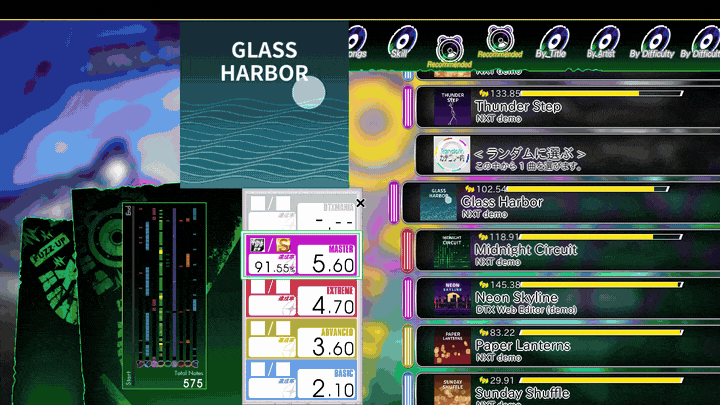
</p>

Song select works like DTXManiaNX v2.0: browse your folders and BOXes, sort by title, artist, level or skill, and see your lamp, rank and best achievement for every difficulty.
If you played these songs in DTXManiaNX, the best results in its `score.ini` files are brought in once, so your lamps and ranks are there from the start.

<table>
<tr>
<td width="50%" valign="top">
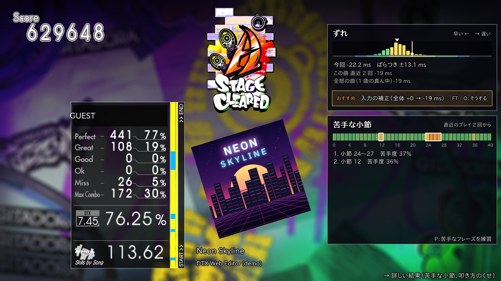
<br><sub>The result screen, with your timing and a suggested offset.</sub>
</td>
<td width="50%" valign="top">
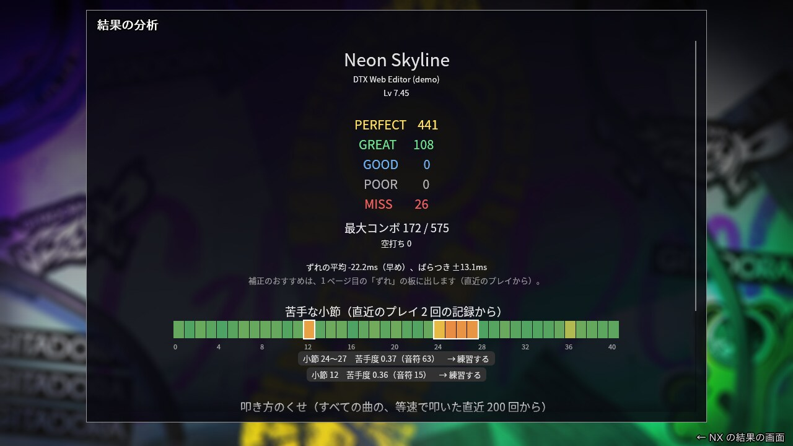
<br><sub>Page 2: your weak bars and phrases, one press away from practice.</sub>
</td>
</tr>
</table>

## Practice the parts you miss

<p align="center"></p>

Press <kbd>P</kbd> on song select or the result screen to open the practice menu (on drums: RD on the result screen, or RD then CY on song select). It lists your weak spots from past plays. Each one comes with a picture of its notes, and the notes you often miss are marked, so you can see which phrase it is, not just a bar number. The selected spot also plays on a loop so you can hear it. Pick one, or choose your own bars, and start. The section loops with a count-in and a metronome, from a slower speed up to your target. When you finish, you are back in the practice menu with the next weak spot selected.

- **One step is 4 laps.** If you don't miss the same beat twice, you move up to the next speed without stopping.
- **Same beat missed twice?** You try that step again. Two tries in a row and it steps down 10 %.
- **Clear the top step** and the section is marked as cleared. When you later play the whole song and that part is no longer weak, the result says so.
- Slowing down keeps the pitch of the music. Timing windows stay in real milliseconds, so slow laps are not easier to judge.

<table>
<tr>
<td width="50%" valign="top">
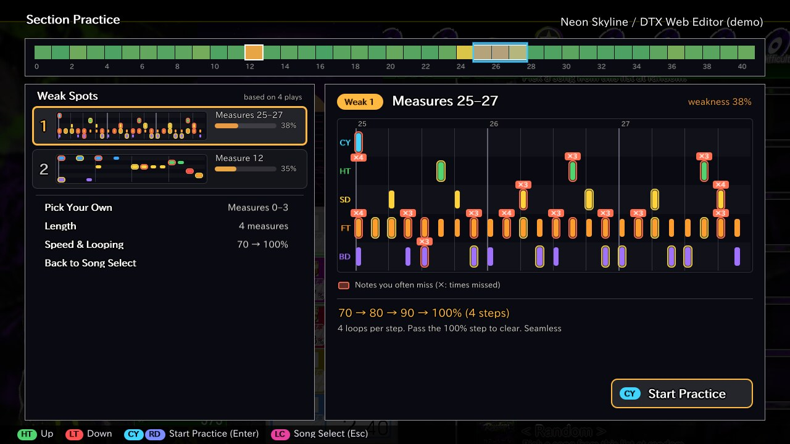
<br><sub>The practice menu: your weak spots, drawn as notes.</sub>
</td>
<td width="50%" valign="top">
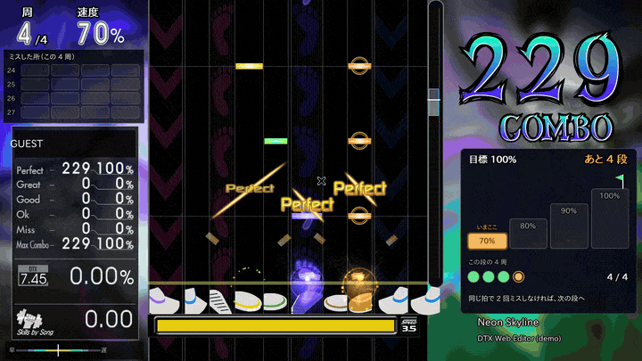
<br><sub>No misses, so it moves up to the next speed.</sub>
</td>
</tr>
<tr>
<td valign="top">
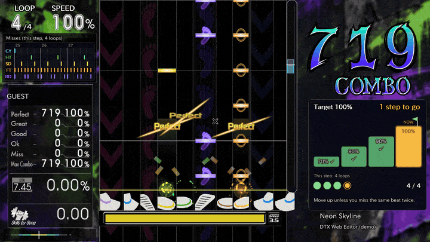
<br><sub>The top step cleared.</sub>
</td>
<td valign="top">
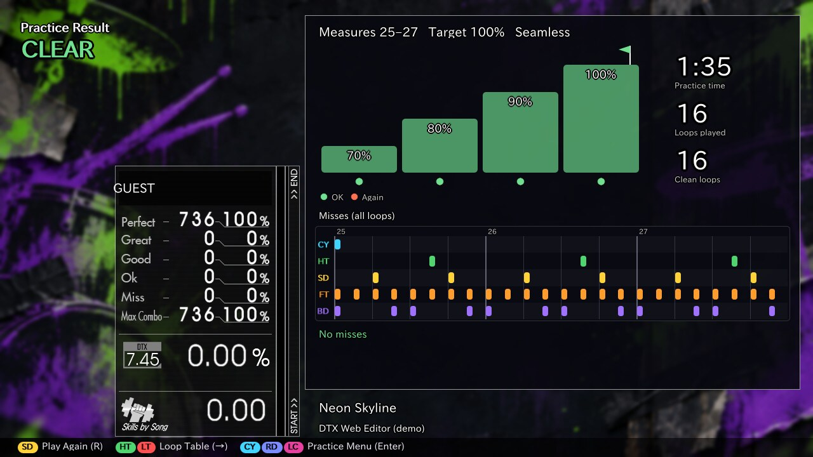
<br><sub>What you practised and where you missed. Next, back to the practice menu.</sub>
</td>
</tr>
</table>

## Timing you can trust

<p align="center"></p>

Your drum hits are timestamped the moment they arrive and compared with where the song actually is in the audio. Window size and frame rate don't change your judgements.

<p align="center"></p>

- **Hit error bar.** While you play, a small bar under the score shows each hit as early or late. It never covers the lanes.
- **Offsets.** One offset for your whole setup (for audio and MIDI latency), plus one per song for charts whose music is a little off.
- **Suggested offset.** The result screen works out an offset from your recent plays. Hit FT (or <kbd>O</kbd>) to use it.

## Made for electronic drums

<p align="center"></p>

- Each MIDI device keeps its own settings: on or off, preset (Roland / GM / none), channel, minimum velocity and pad mapping.
- **Map pads by hitting them.** The app names each lane in turn and you hit the pad for it.
- Hi-hat openness (CC4), cymbal chokes and the snare's head, rim and cross-stick are read. Rim shots are marked on the snare notes of charts that use rim sounds.
- Left bass drum for twin pedals, with four ways to show it.
- A volume mixer for the whole game, the music, your hit sounds, the metronome and sound effects.

## Updates

<p align="center"></p>

When a new version is out, a row appears under the title menu (Windows, installed with the Setup.exe). Choose it, keep playing while it downloads, then restart to switch. Your settings and play records stay where they are.

## FAQ

<details>
<summary><b>Do I need DTXManiaNX or DTXMania installed?</b></summary>

No. Everything the app needs, including the screens and sounds, comes in the installer. Just bring your songs.
</details>

<details>
<summary><b>Can I use my DTXManiaNX songs and scores?</b></summary>

Yes. Add your NX song folder (or the NX folder itself). Best results from DTXManiaNX's `score.ini` files are imported once when the songs are scanned: achievement, score and the progress bar, so lamps, ranks and skill carry over. They don't include per-note results, so weak-spot analysis starts from your plays in DTXmaniaNXT.
</details>

<details>
<summary><b>Guitar and bass?</b></summary>

No. DTXmaniaNXT is drums only.
</details>

<details>
<summary><b>Can I switch the game to Japanese?</b></summary>

Yes. The game starts in English. Change it under Config → General → Language (言語).
</details>

<details>
<summary><b>macOS and Linux?</b></summary>

Download the `.tar.gz` for your system from the [releases page](https://github.com/check5004/DTXmaniaNXT/releases/latest) and extract it. On macOS, run `xattr -d com.apple.quarantine dtxmanianxt` in the extracted folder before the first start, because the app isn't signed. Linux needs ALSA (`libasound2`). Automatic updates are Windows only.
</details>

<details>
<summary><b>Do chart videos (#AVI) play?</b></summary>

On Windows, yes. They play behind the lanes, read by Windows' own Media Foundation (MP4 H.264, AVI Xvid and DivX). macOS and Linux don't play them yet.
</details>

<details>
<summary><b>Where are my settings and records?</b></summary>

In `%APPDATA%\DTXmaniaNXT` on Windows (`config.toml` for settings, `records.sqlite` for every note you played, and `dtxmanianxt.log`). Updating or reinstalling keeps them. Uninstall from Windows Settings → Apps; your settings and records are left in place.
</details>

<details>
<summary><b>How do I make my own charts?</b></summary>

Use [DTX Web Editor](https://github.com/check5004/dtx-mania-web-editor), a free drum chart editor that runs in your browser (by the same author). You can open it from Config → Songs → Open Chart Editor. It saves DTX song folders you can play here and in DTXMania; choose Rescan Songs to see your edits in the list.
</details>

<details>
<summary><b>Something is wrong.</b></summary>

Please open an [issue](https://github.com/check5004/DTXmaniaNXT/issues). Attaching `dtxmanianxt.log` from the folder above helps a lot.
</details>

**The full guide** (every setting, practice rules and the files the app writes) is in Japanese: [docs/guide.ja.md](docs/guide.ja.md).

## Credits and rights

DTXmaniaNXT is an **unofficial fan project**. It would not exist without more than twenty years of work by the DTXMania community. Thank you to everyone who has made and kept DTXMania and its forks going.

<p align="center">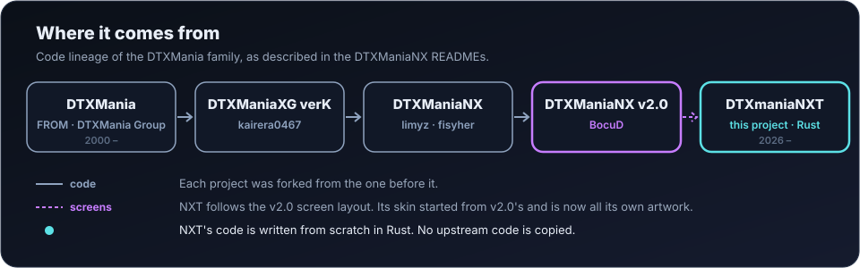</p>

### The DTXMania family

| Project | By | Notes |
| --- | --- | --- |
| [DTXMania](https://dtxmania.net/) | FROM | The original DTXMania and the DTX format, since 2000. Still developed today (DTXMania 4). The site reads “© 2000 FROM / Kenji yamazaki”, and DTXMania's license names “Copyright (C) 2000 2010 DTXMania Group”. |
| [DTXMania (OSDN)](https://osdn.net/projects/dtxmania) | yyagi | DTXMania as developed on OSDN, home of the [DTX data format wiki](https://osdn.net/projects/dtxmania/wiki/DTX%20data%20format). |
| [DTXManiaXG verK](https://osdn.net/projects/dtxmaniaxg-verk) | kairera0467 | The fork that DTXManiaNX started from. |
| [DTXManiaNX](https://github.com/limyz/DTXmaniaNX) | limyz / fisyher | This repository is a GitHub fork of it. |
| [DTXManiaNX v2.0](https://github.com/BocuD/DTXmaniaNX) | BocuD | The screen layout comes from this version, and so does the part of the skin not yet replaced. |
| [DTXMania AL](http://senamih.com/dtxal) | Sena | Another DTXMania fork, listed with the others in the DTXManiaNX README. |

The names and the order above follow the DTXManiaNX READMEs and the projects' own pages. If something here is wrong, please tell us in an [issue](https://github.com/check5004/DTXmaniaNXT/issues).

### What is in this repository

- **The code** (the `main` branch) is new code written in Rust for this project. It contains no code from DTXMania or DTXManiaNX; their features are re-implemented to behave the same way. It is under the [MIT License](LICENSE).
- **The skin** (`assets/skin`, the images and sounds you see and hear) started as the DTXManiaNX v2.0 skin and **is being replaced with original artwork, step by step**. It is built into the app so that it runs without DTXManiaNX. Details for every file: [assets/README.md](assets/README.md).

  | Step | What | Now |
  | --- | --- | --- |
  | 1 | Images that contained KONAMI's GITADORA artwork or logos (backgrounds, title logo, shutter, STAGE FAILED, ranks and more) | **Replaced** with artwork made for DTXmaniaNXT (23 files). Unused ones were deleted. |
  | 2 | Sound effects and voices | Still from DTXManiaNX v2.0 |
  | 3 | All other images (judgement text, gauge, pads, sort icons and more) | Still from DTXManiaNX v2.0 |

  - **Our artwork** (step 1) is under [CC BY 4.0](https://creativecommons.org/licenses/by/4.0/); please credit “DTXmaniaNXT”. It was made with an image-generation AI (OpenAI GPT Image 2.6 Sunburst, through OpenRouter), then cropped, resized and lettered. The prompts are in `tools/skin/prompts.json`; they don't name any existing game or product.
  - **Everything else in the skin** is copied unchanged from the `Runtime/System` folder of [BocuD/DTXmaniaNX](https://github.com/BocuD/DTXmaniaNX) at tag `V2.0.0-20260121-5`. It is under neither the MIT License nor CC BY. Its rights stay with its original creators; there is no record of who made each image or sound. The DTXManiaNX repositories have no license file, and DTXMania's own license (`Runtime/Licenses/dtxmania.txt`, MIT-style) covers the DTXMania software, not these files.
  - Releases up to 0.8.0 and older commits still contain the images from before step 1.
- **The app icon** is DTXManiaNX's `dtx.ico` (an icon handed down from DTXMania) with its “DTX” lettering changed to “NXT”. It is not under the MIT License either.
- **The `master` branch** keeps the upstream C# DTXManiaNX code for reference only. Our license doesn't apply to it.

### Trademarks

GITADORA is a trademark of Konami Digital Entertainment Co., Ltd. The screen layout follows KONAMI's GITADORA series. Up to version 0.8.0, the bundled skin contained artwork and logos taken straight from GITADORA FUZZ-UP; step 1 replaced all of them. Some of the parts still left from DTXManiaNX v2.0 are made to look like GITADORA's screens, and steps 2 and 3 will replace them. DTXmaniaNXT is not affiliated with or endorsed by KONAMI, or by the developers of DTXMania or DTXManiaNX.

**If you hold rights to anything here and want it changed or removed, please open an [issue](https://github.com/check5004/DTXmaniaNXT/issues). We will act on it promptly.**

### Other credits

- XA sound decoding was written from the format description in [bjxa](https://github.com/dridi/bjxa)'s `bjxa(5)` manual. No code was copied.
- Built with [wgpu](https://wgpu.rs/), [egui](https://github.com/emilk/egui), [winit](https://github.com/rust-windowing/winit), [cpal](https://github.com/RustAudio/cpal), [midir](https://github.com/Boddlnagg/midir), [Symphonia](https://github.com/pdeljanov/Symphonia), [rusqlite](https://github.com/rusqlite/rusqlite), [timestretch](https://github.com/robmorgan/timestretch-rs), [Velopack](https://velopack.io/) and other open-source crates. Their licenses are listed in `THIRD-PARTY-LICENSES.html` on every [release](https://github.com/check5004/DTXmaniaNXT/releases).
- Sister project: [DTX Web Editor](https://github.com/check5004/dtx-mania-web-editor), the chart editor.

### About the pictures

The screenshots and clips come from the current development build, so details may differ slightly from the release you download. They show the skin after step 1, with the English screens (the Japanese README shows the Japanese screens). All songs shown are demo songs made for these pictures, not real songs: “Neon Skyline” is the original demo song of DTX Web Editor, and the other titles are made-up names given to copies of it. The play records shown are made up as well.

## For developers

DTXmaniaNXT is a Cargo workspace. Rust stable is all you need (on Linux, also `libasound2-dev`).

```sh
cargo run -p dtxmanianxt                        # start at the title screen
cargo run -p dtxmanianxt -- path/to/song.dtx    # play one chart right away
cargo fmt --all --check
cargo clippy --all-targets -- -D warnings
cargo test --all
```

Set `DTXMANIANXT_AUTOPLAY=1` to have every note hit automatically while you check the screens.

| Path | What's in it |
| --- | --- |
| `crates/dtx` | DTX parser: text encoding, headers, chips, timing from BPM and measure length |
| `crates/engine` | Judging, audio and MIDI clocks, e-drum input normalisation, weak-spot analysis, practice loops |
| `crates/library` | Song folder scanning (`set.def`, `box.def`) and song select sorting |
| `crates/records` | Play records (SQLite) |
| `crates/nx` | Reading DTXManiaNX folders (`Config.ini`, `score.ini`) |
| `crates/video` | Chart videos (#AVI), via Media Foundation on Windows |
| `crates/i18n` | English and Japanese text for the screens |
| `crates/app` | The app: winit + wgpu + egui, cpal, midir. Draws the NX skin at the same coordinates as upstream |
| `assets/skin` | The bundled skin, being replaced with our own artwork (see [Credits and rights](#credits-and-rights)) |
| `tools/skin` | Prompts and build scripts for the new skin artwork |
| `testdata/charts` | Test charts with hand-checked expected results |

- How judging works: hits are judged by MIDI arrival time and audio playback position, never by frame.
- DTX parsing follows upstream DTXMania behaviour and [DTX Web Editor](https://github.com/check5004/dtx-mania-web-editor)'s `src/dtx`. When it changes, add a chart and its expected result to `testdata/charts`.
- Releases: bump `version` in `Cargo.toml` on `main` and the Release workflow builds the installer, auto-update packages and the macOS / Linux archives. See [docs/releasing.md](docs/releasing.md) (Japanese).
- README pictures: the animated SVGs are generated by `python3 tools/readme/make_svgs.py` (standard library only, English and Japanese). `tools/readme/player.py` plays a chart like a person by sending keys, for recording clips.

Pull requests go to `main` of this repository (check5004/DTXmaniaNXT), not to the upstream it was forked from.

## License

The code on the `main` branch is under the [MIT License](LICENSE). The skin in `assets/skin` (our artwork is CC BY 4.0, the rest is from DTXManiaNX v2.0), the app icon in `assets/icon` and the upstream code on the `master` branch are not covered by it (see [Credits and rights](#credits-and-rights)).
